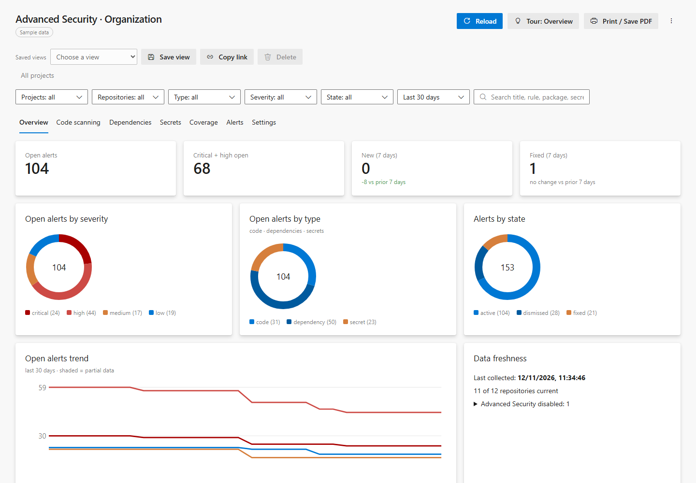
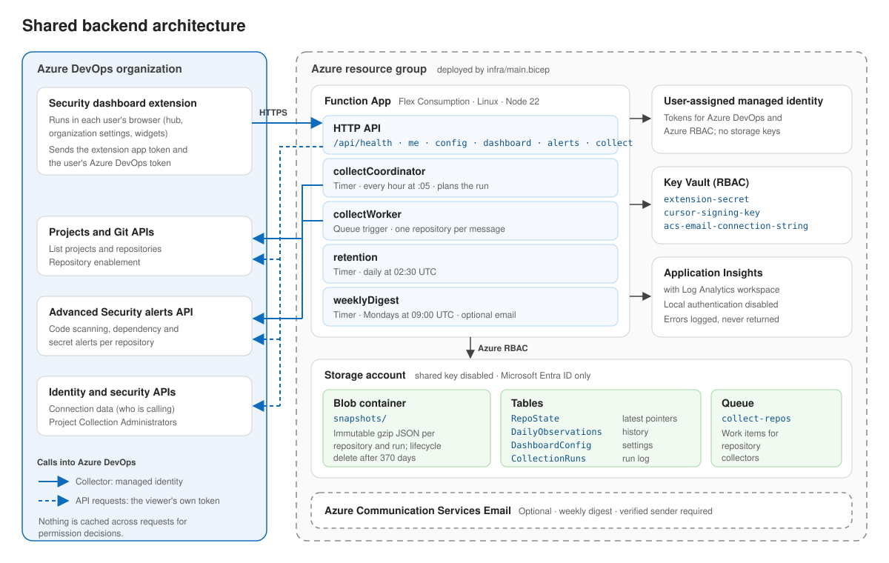

# GHAzDO Dashboard

An Azure DevOps Services extension that brings together **GitHub Advanced Security for Azure DevOps** alerts (code scanning, dependency scanning and secret scanning) for every project and repository into one dashboard.

- **Organization hub**: *Advanced Security → Security dashboard*, or *Organization settings → Extensions section → Advanced Security dashboard*. Filters and drill-down cover projects, repositories, alert types, severities, states, period and search.
- **Project hub**: *Advanced Security → Security dashboard* in the project's left menu (after Artifacts). Locked to the current project, with drill-down to repositories.
- **Tabs**: Overview, Code scanning, Dependencies, Secrets, Coverage, Alerts, plus Settings in the organization hub only. Alerts show a reported branch or ref when available, not necessarily every affected branch.
- **Widgets**: summary, severity, top repositories, exposed secrets. Each has a scope setting (this project or the whole organization) and repository and type filters. Clicking a widget opens the hub with the same filters.
- **Shareable views**: filters and the selected tab are kept in the URL hash.



*The screenshots use sample data. Secret values, code snippets and file paths are never displayed.*

## Repository layout

| Path | Contents |
| --- | --- |
| `packages/shared` | Alert normalization, ADO client and collector, filters, aggregation (shared by browser and backend) |
| `apps/extension` | React 18 + Vite extension built with `azure-devops-ui` (Formula Design System): hubs, widgets, widget configuration, `vss-extension.json`. See [Development](apps/docs/content/development.md#extension-ui) for why React 18 and `legacy-peer-deps` |
| `apps/functions` | Optional Azure Functions v4 backend (scheduled collection, shared history, API) |
| `infra` | Bicep for the backend (Flex Consumption, Storage, Key Vault, App Insights, managed identity) |
| `apps/docs` | Documentation site (React + Fluent UI v9), deployed to GitHub Pages. Pages are markdown in `apps/docs/content` |
| `.github/workflows` | GitHub Actions: CI, releases, Pages |

## Data modes

| Mode | Collection | History |
| --- | --- | --- |
| **Browser-only** (default) | Runs in each user's browser with their own token, so it only sees repositories that user can read | IndexedDB cache per organization and user. **Optional per-user history in Azure DevOps**: if an admin enables *Allow users to save history in Azure DevOps* and the user opts in, daily summaries (counts only) go to User-scoped extension data. The browser database is then a cache, and history follows the user across browsers. |
| **Shared backend** (optional) | The Function App collects hourly with a managed identity | Organization-wide history in Azure Storage, kept for up to 365 days |

The data that gets stored is limited to an allowlist of metadata. Secret values, code snippets and file paths are never stored.

## Develop

Requires Node 20 or later.

```powershell
npm install
npm run validate          # typecheck, lint, test, build
npm run dev --workspace apps/extension
```

Outside Azure DevOps, the UI runs on **fixture data**:
- `http://localhost:5173/hub.html` opens the organization dashboard.
- `project-hub.html` opens the project dashboard.
- `widget.html?kind=secrets` opens a widget.

To preview the docs site, run `npm run docs:dev`.

## GitHub Actions

| Workflow | Trigger | What it does |
| --- | --- | --- |
| `ci.yml` | Push to `main`, PRs, manual | Validate, build Bicep, package the VSIX and `functions.zip`, upload them as an artifact |
| `release.yml` | Tag `v*.*.*`, or manual with a version | Package with that version, create a GitHub release (VSIX, `functions.zip`, `main.json`, `SHA256SUMS.txt`), optionally publish to the Marketplace, redeploy the docs |
| `pages.yml` | Push to `main` under `apps/docs`, manual, called by release | Build `apps/docs` and deploy it to GitHub Pages |
| `dependency-review.yml` | Pull requests to `main` | Reject newly introduced high or critical vulnerable dependencies |

Actions are pinned to immutable commit SHAs. Dependabot checks npm dependencies and action pins weekly. Build jobs use read-only tokens; release publishing and Pages deployment receive write permissions only in isolated jobs. Manual releases run from `main`.

One-time setup:
- Set *Settings → Pages → Source* to **GitHub Actions**.
- Repository variables:
  - `MARKETPLACE_PUBLISHER` (required for releases).
  - Optional: `VITE_BACKEND_ALLOWLIST`, `PUBLISH_TO_MARKETPLACE` (`true`), `MARKETPLACE_SHARE_WITH`.
- Secret `MARKETPLACE_PAT`, only needed when publishing. The publish job runs in the `marketplace` environment.

## Package and publish the extension

1. In `apps/extension/vss-extension.json`, set `publisher` to your Marketplace publisher ID (currently `4workers`). The extension ID is `ghazdo-security-dashboard`, starting at version `0.0.1`.
2. Optional: set the backend origins the extension may call when you build it:
   ```powershell
   $env:VITE_BACKEND_ALLOWLIST = "https://ghazdo-func-xxxx.azurewebsites.net"
   ```
   If you leave the allowlist empty, the build only supports browser-only mode. Any URL an admin enters must match the allowlist.
3. Run `npm run package:vsix`. This writes `out/*.vsix`.
4. Upload the package as a **private** extension, share it with your organization, then install it.

## Deploy the optional backend



Collection, request and authorization flows are documented in [apps/docs/content/backend.md](apps/docs/content/backend.md).

```powershell
az group create -n rg-ghazdo -l westeurope
az deployment group create -g rg-ghazdo -f infra/main.bicep `
  -p adoOrganization=contoso allowedOrigins="['https://<publisher>.gallerycdn.vsassets.io']" `
  -p extensionSecret=$env:EXT_SECRET
npm run package:functions
az functionapp deployment source config-zip -g rg-ghazdo -n <functionAppName> --src apps/functions/functions.zip
```

Then:
1. **Give the managed identity access to Azure DevOps.**
   - Add the `managedIdentityClientId` output as a user in the organization.
   - Grant it read access to projects and repositories, and *Advanced Security: Read alerts*.
2. **Set the extension secret.** It is the Marketplace extension certificate. Pass it at deployment time or set the `extension-secret` Key Vault secret later.
3. **Connect the dashboard.** In the dashboard's **Settings** tab, an organization admin sets **Backend URL** (`backendUrl` output) and uses **Test connection**.

Snapshot blobs expire after 370 days through a lifecycle rule. That rule also removes data for repositories that were deleted.

## Security notes

See [SECURITY.md](SECURITY.md) for supported versions and private vulnerability reporting.

- **Admin checks:** in browser-only mode, the admin-only Settings UI is gated client-side through a Graph membership check. Shared settings are stored in extension data, which any user of the extension can technically write. Treat those settings as configuration, not as a security boundary. The backend URL is always checked against the build-time allowlist.
- **Backend authentication:** the backend checks the extension app token (HS256, signed with the extension secret), enforces a CORS allowlist, and uses HMAC-signed paging cursors.
- **Read permissions:** browser-only collection never goes beyond the signed-in user's permissions.

## Not yet verified against a live organization

These items are implemented from documentation but have not been exercised end-to-end:

- The app token `iss`/`aud` values. Setting `APP_TOKEN_ISSUER`/`APP_TOKEN_AUDIENCE` is optional; they are skipped when empty.
- The Graph-based Project Collection Administrators check.
- The error shape for extension-data `__etag` conflicts. Conflict detection matches status 409/412 and `InvalidDocumentVersion`.
- The widget-to-hub deep link format (`_apps/hub/{publisher}.{extension}.{hubId}`) and how the organization navigation and Organization settings entries render.
